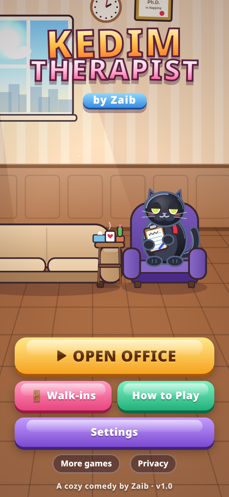
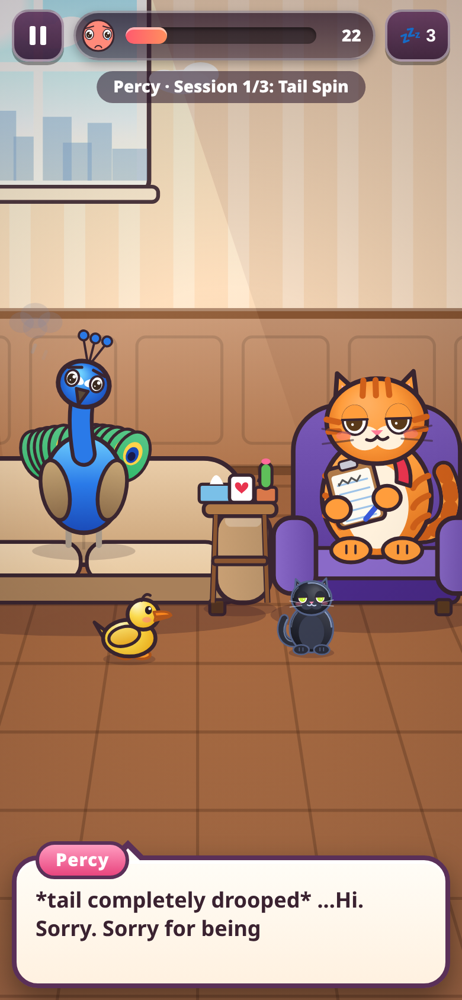

# Kedim Therapist by Zaib

A cozy, funny therapy-office game for mobile and desktop browsers.

You play as **Dr. Kedim**, a ginger tabby cat therapist with a red scarf, a dry sense of humour, a Ph.D. in Napping, and a habit of knocking things off the desk. Silly animal patients come to his office with funny problems. A dog is terrified of the mailman. A ghost is scared of the dark. A dragon has anger issues and keeps setting the couch on fire. Help them all feel better and graduate.

**Play:** https://zaibgames.com/kedim-therapist/

 

## Features
- **36 story sessions with 12 patients** (dog, goldfish, pigeon, sloth, peacock, raccoon, ghost, chicken, dragon, owl, bear, mouse). Each patient has a 3-session follow-up story and a graduation celebration.
- **Branching replies**: choose a Kind, Funny or Wise answer. Good answers raise the mood meter. Wrong answers lead to comic disasters (feathers everywhere, scorched cats, patients fleeing).
- **7 therapy mini-games**: Breathe With Me, Untangle Thoughts (yarn), Feelings Match, Worry Jar, Ink Blot Test, Purr Therapy and Whack-a-Thought.
- **Coins and star reviews**, plus a day/week appointment calendar.
- **Shop**: 30 office decorations that appear in the office, 21 Kedim outfits, 9 fur colours, and 5 upgrades (tea, blanket, white noise, treats, nap pillow).
- **Office pets**: Ducky the duck and Mei Mei the black cat (she loves a good pat) wander the office, react to patients and taps, and help out with small bonuses (toggle them in Settings).
- **Midnight office theme**: a moonlit night office with warm lamp glow and stars (Settings).
- **Kedim's Notebook**: patient files with session notes and reviews.
- **26 achievements**.
- **Endless walk-in clinic** with randomly generated patients, plus a **daily patient** that pays double coins and builds a streak.
- Typewriter speech bubbles with species "babble" voices, animated expressions and emotes, cozy lighting and particles.
- Generated lo-fi music and sound effects (WebAudio, no audio files).
- Occasional gentle, family-friendly mental-health tips.
- Saves automatically in localStorage.

## Controls
- **Tap** the dialogue box to advance. **Tap** a reply to choose it.
- **💤 Insight Nap**: Kedim naps and highlights the best reply. Hints are limited.
- **Mini-games**: tap, drag or hold, as explained on each intro card.
- **In the office**: tap Kedim to pet him, and tap the desk items so he knocks them over.
- **Keyboard**: Space/Enter advances dialogue, 1–3 picks a reply, Esc pauses.

## Tech
A single self-contained `index.html` (canvas 2D + DOM UI + WebAudio) with no external assets. It is portrait-first and also supports landscape. It runs at 60 fps using delta time, drops graphics quality automatically on slow devices, and pauses when the tab is hidden.

Game by Zaib. More games: https://zaibgames.com/
